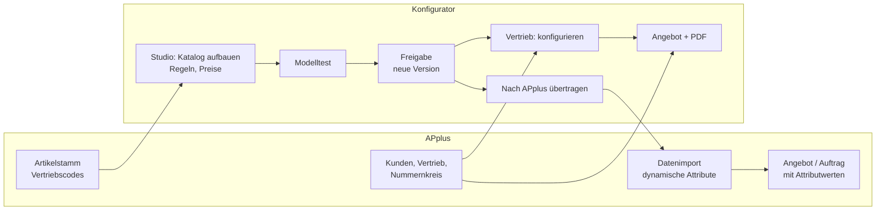
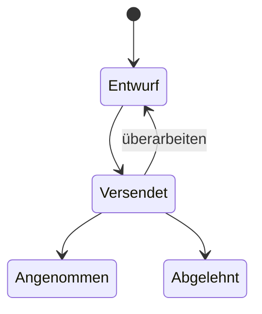

# 02 Prozesse

## Überblick

## Rollen

| Rolle | Aufgaben | Bereiche |
|---|---|---|
| Produktmanagement | Katalog aufbauen, Feldtypen, Regeln, Preise, Modelltest, Freigabe, Übertragung nach APplus | Studio |
| Vertrieb | Fahrzeug wählen, konfigurieren, Angebot erstellen, Status pflegen | Vertrieb |
| Vertriebsleitung | Angebotsvorlagen, Briefpapier, Nummernvergabe, Protokoll prüfen | Studio › Angebotsdesigner, Einstellungen, Protokoll |
| APplus-Betreuung / IT | Abfragen einrichten, Datenimport ausführen, Systemkonfiguration | APplus |

Schreibrechte: Ist die Anwendung im Speichermodus „Datenbank“, prüft sie die Berechtigung `data.write`. Ohne Schreibrecht ist das Studio nur lesbar.

## Prozess 1: Katalog pflegen

1. **Codes bereitstellen.** Neue Vertriebscodes werden als Artikel in APplus angelegt (Nummer, Bezeichnung, VK-Preis, Herstellkosten).
2. **Katalog aufbauen** (Studio › Katalog aufbauen):
   - Familie und Fahrzeuge anlegen oder per Drag & Drop umhängen.
   - Codes aus dem Artikel-Pool anhaken oder als Liste einfügen; das Codesystem gliedert automatisch (ZZ = Überschrift, YY = Gruppe, GA = fest).
   - Feldtyp je Code prüfen (Auswahl, Ja/Nein, Zahl, Freitext, fest), Standardauswahl mit ☆ setzen.
   - Gemeinsame Struktur auf die Familie hochziehen, Abweichungen bleiben am Fahrzeug.
3. **Preise je Produktgruppe** (Studio › Excel-Import): Codes und Preise aus der Excel-Mappe für die gewählte Gruppe übernehmen. APplus-Stammpreise bleiben führend, solange am Code nichts von Hand überschrieben wurde.
4. **Regeln pflegen** (Studio › Regeln): „wenn … dann sperrt / erlaubt nur / setzt“, Kombinationstabellen, Hinweistexte. Kontrolle in Matrix und Regelgraph.
5. **Modelltest** (Studio › Modelltest): spielt je Fahrzeug alle Kombinationen der Auswahlgruppen durch (bis 400.000). Er zählt die gültigen Kombinationen und meldet Widersprüche, also Gruppen, in denen alles gesperrt ist. Außerdem nennt er Codes, die nie wählbar sind, und Regeln, die nie greifen.
6. **Freigabe** (Studio › Freigabe): zeigt die Änderungen gegenüber der letzten Version; mit „Version n veröffentlichen“ wird der Entwurf für den Vertrieb sichtbar. „Entwurf verwerfen“ setzt auf die letzte Version zurück.

Grundsatz: **Der Vertrieb arbeitet immer mit der freigegebenen Version.** Änderungen im Studio wirken erst nach der Freigabe.

## Prozess 2: Angebot erstellen

1. Katalog öffnen, Familie und Fahrzeug wählen. Der „ab“-Preis ist der Preis der Standardkonfiguration.
2. Konfigurieren: Registerkarten je Überschrift, Auswahl je Gruppe. Gesperrte Codes sind markiert, automatische Änderungen werden mit Regel angezeigt.
3. „Angebot“: Kunde aus APplus wählen (oder neu), Bearbeiter kommt aus dem Vertrieb.
4. Angebotsnummer: aus dem ERP-Nummernkreis (Einstellung „Nummern aus dem ERP“), sonst aus dem eigenen Zähler; die Quelle steht am Angebot.
5. Vorlage wählen (je Produktfamilie voreinstellbar), „Dokument ansehen“, drucken oder als PDF speichern.
6. Status pflegen: Entwurf → Versendet → Angenommen / Abgelehnt.

## Prozess 3: Übergabe an APplus

1. Studio › **Nach APplus**: Fahrzeuge auswählen, Attributklasse prüfen (höchstens 12 Zeichen), Mandant, Status, erste Regelnummer.
2. Vorschau der Tabellen und Hinweise prüfen.
3. „Mappe für den APplus-Datenimport herunterladen“.
4. In APplus: Mappe mit dem Datenimport einlesen, Attributklasse am Fahrzeugartikel eintragen, VariantenParserAdapter2 aktivieren, „Attributdialog Regeln aktiv“ setzen, Regelaktionen (SDRPOS) prüfen bzw. nach der Regelübersicht erfassen.
5. Test: Angebotsposition mit dem Fahrzeug anlegen, Attributdialog öffnen, Regeln ausprobieren.

Wann übertragen: nach jeder Freigabe, die Struktur, Codes, Regeln oder Preise eines Fahrzeugs ändert. Details in [05 APplus-Anbindung](05-applus-anbindung.md).

## Prozess 4: Vorlagen und Briefpapier

1. Studio › Angebotsdesigner: Vorlage anlegen oder kopieren.
2. Briefpapier als PDF hochladen (erste Seite und Folgeseiten), Ränder einstellen.
3. Bausteine per Drag & Drop anordnen, Platzhalter für Kunde, Nummer, Datum, Bearbeiter usw. einsetzen.
4. Vorlage einer Produktfamilie zuordnen oder als Standard setzen.

## Prozess 5: Änderungen an der Anwendung

Änderungen am Programm laufen über GitHub (`Fema10/fahrzeugkonfigurator`): größere Änderungen auf einem eigenen Branch mit Pull Request, Prüfung durch die Fachseite, dann Merge. Danach `dist/konfigurator.js` und `dist/konfigurator.css` im Dashboard austauschen. Siehe [07 Betrieb und Entwicklung](07-betrieb-und-entwicklung.md).
