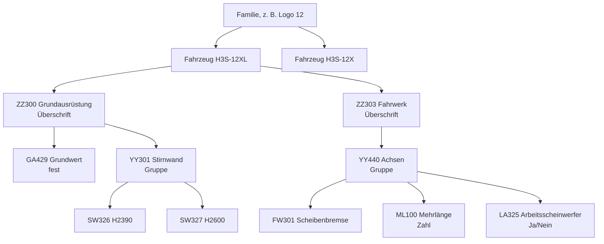

# 04 Codesystem und Katalog

## Aufbau des Katalogs

- **Familie**: Strukturen, Preise und Regeln können an der Familie hängen und gelten dann für alle Fahrzeuge darunter. Ein Fahrzeug kann einzelne Werte, die Standardauswahl oder Preise abweichend festlegen.
- **Fahrzeug**: der Artikel, der im Angebot steht. Grundpreis und Grundstückliste.
- Die **Reihenfolge der Codes** am Fahrzeug (`codeFolge`) entspricht der Reihenfolge in der Liste bzw. Excel-Mappe.

## Codesystem

| Kennung | Bedeutung | Im Konfigurator | Im Angebot |
|---|---|---|---|
| **ZZ…** | Überschrift | Registerkarte bzw. Abschnitt | wird als Zwischenüberschrift gedruckt, Positionen darunter gruppiert |
| **YY…** | Untergruppe | gruppiert Codes zu einer Auswahl | wird **nicht** extra gedruckt |
| **GA…** | Grundausstattung | fest, nicht abwählbar | als Position ohne Wahl |
| andere Buchstaben | Vertriebscode | wählbar je nach Feldtyp | Position mit Code, Text, ggf. Preis |

Die Kennungen sind in Studio › Einstellungen › Code-Kennzeichen änderbar.

Die Bezeichnungen von ZZ- und YY-Codes kommen aus dem Text in der Liste bzw. aus dem Artikelstamm.

## Automatische Gliederung

Beim Einfügen einer Code-Liste oder einem Struktur-Import gliedert die App selbst:

1. Ein ZZ-Code beginnt eine neue Überschrift.
2. Ein YY-Code beginnt eine neue Gruppe innerhalb der Überschrift.
3. Codes ohne YY werden nach gleichem Präfix zusammengefasst (z. B. `SW…`).
4. Innerhalb einer Gruppe wird die **größte Gruppe von mindestens zwei Codes mit gleichem Präfix** zur Auswahl „genau einer“. Die übrigen Codes werden Ja/Nein-Optionen.
5. GA-Codes werden „fest“.

Das Ergebnis ist ein Vorschlag. Jeder Code kann danach einen anderen Feldtyp bekommen.

## Feldtypen je Code

| Feldtyp | Verhalten | Beispiel |
|---|---|---|
| **Auswahl** | einer aus der Gruppe (Kacheln, Liste oder Dropdown) | Stirnwand H2390 / H2600 |
| **Ja/Nein** | eigenes Häkchen, unabhängig von der Auswahl, optional vorab angekreuzt | Arbeitsscheinwerfer |
| **Zahl** | Eingabe mit Einheit, von/bis, Schritt, Standardwert; Preis × Menge | Mehrlänge je 100 mm |
| **Freitext** | Texteingabe mit maximaler Länge und Hinweis | Beschriftung Bordwand |
| **fest** | immer enthalten, nicht abwählbar | Grundwert LOGO 12XL |

Gruppentyp (Darstellung der Auswahl): **Kacheln**, **Liste**, **Dropdown** oder **Mehrfach** (mehrere Codes ankreuzbar).

## Standardkonfiguration

- Je Gruppe ist ein Code als Standard markiert (☆). Ohne Markierung gilt der erste Code, außer die Gruppe ist Pflicht ohne Vorauswahl.
- Ja/Nein-Codes können „vorab angekreuzt“ sein.
- Der „ab“-Preis im Katalog ist der Preis der Standardkonfiguration.

## Regeln

| Art | Wirkung |
|---|---|
| sperrt | die genannten Codes sind nicht wählbar, wenn die Bedingung zutrifft |
| erlaubt nur | nur die genannten Codes sind wählbar |
| setzt | die genannten Codes werden automatisch gewählt |
| Kombinationstabelle | nur die aufgeführten Kombinationen zweier (oder mehrerer) Gruppen sind erlaubt |

- Mehrere Bedingungen einer Regel gelten zusammen (UND). Mehrere Codes in einer Bedingung bedeuten „einer davon“ (ODER).
- Regeln gelten für alle Fahrzeuge oder nur für bestimmte Familien und Fahrzeuge.
- Der Konfigurator bereinigt nach jeder Änderung: Ungültige Auswahlen werden ersetzt, und die Änderung wird mit der auslösenden Regel angezeigt.

## Preise

Reihenfolge, nach der ein Preis gilt (das Erste, was vorhanden ist, gewinnt):

1. Preis des Codes am **Fahrzeug**
2. Preis an der **Familie**. Die nächstgelegene Familie gewinnt, von der direkten Familie nach oben im Familienbaum.
3. Preis am **Code**. Er wird beim Laden aus dem APplus-Artikelstamm überschrieben, sofern er nicht von Hand geändert wurde (`apStamm`).

Der Excel-Import „Codes und Preise“ schreibt Preise an die gewählte Produktgruppe.

Eine Preis- oder Namensänderung von Hand schaltet den Stammabgleich für diesen Code ab. Mit dem Häkchen „aus APplus“ wird er wieder eingeschaltet.

## Quellen der Daten

| Information | führend |
|---|---|
| Code, Bezeichnung, VK-Preis, Herstellkosten | APplus-Artikelstamm (`ARTIKEL.ARTIKEL`) |
| Gruppenpreise je Familie | Studio bzw. Excel-Import |
| Struktur, Feldtypen, Standard, Regeln | Studio |
| Kunden, Vertrieb, Angebotsnummer | APplus |
| Angebotsvorlagen, Briefpapier | Studio › Angebotsdesigner |
