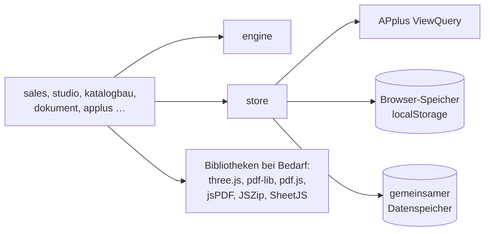

# 06 Architektur

## Grundsätze

- Reines JavaScript und CSS ohne Framework und ohne Build-Werkzeug zur Laufzeit. Das Paket besteht aus zwei Dateien: `konfigurator.js` und `konfigurator.css`.
- Die App hängt sich in `#content` des APplus-Dashboards ein. Alle Stile sind auf `#konfigurator` begrenzt, globale APplus-Stile werden innerhalb neutralisiert. Die Adresszeile wird nicht verändert.
- Die Logik (Engine) ist von der Oberfläche getrennt und läuft auch in Node, für Tests und Importe.
- Alle Daten laufen über eine Datenschicht (`K.Store`). Nur sie kennt die Speicherorte.

## Module

Alle Module hängen an `window.KONF` (kurz `K`). Reihenfolge im Paket (siehe `tools/bundle.js`):

| Datei | Aufgabe |
|---|---|
| `core.js` | Konfiguration `K.cfg`, Hilfsfunktionen, Router (`K.route`, `K.render`, `K.gehe`), Ereignisverteilung über `data-act`, `data-in`, `data-chg`, Nachladen von Bibliotheken (`K.lib`) |
| `engine.js` | Vererbung Familie → Fahrzeug, Feld- und Gruppentypen, Regeln, Bereinigung, Preis, Kosten, Stückliste, Modelltest |
| `store.js` | Datenschicht: Entwurf/Live, Freigabe, Kunden, Angebote, Einstellungen, Protokoll, APplus-Abfragen, Stammabgleich, Nummernvergabe |
| `viewer3d.js` | 360°-Ansicht mit three.js r128, GLB-Modell oder Ersatzmodell |
| `pdf.js` | ältere PDF-Ausgabe mit jsPDF (Rückfall) |
| `sales.js` | Vertrieb: Übersicht, Katalog, Konfigurator, Angebote, Kunden, Verkaufsraum |
| `studio.js` | Studio: Regeln, Modelltest, Freigabe, Einstellungen, Protokoll, Merkmale, Produkte |
| `modell.js` | Produktmodell (Familienbaum, Vererbung) |
| `excel.js` | Excel-Import/-Export der Produktfamilie, Vorlage |
| `liste.js` | Struktur-Import aus Liste oder Mappe, Spaltenerkennung |
| `preise.js` | Import „Codes und Preise“ je Produktgruppe |
| `katalogbau.js` | Katalog aufbauen: Baum, Drag & Drop, Artikel-Pool, automatische Gliederung (`K.kbStrukturieren`) |
| `dokument.js` | Angebotsdesigner und Dokument: Bausteine, Platzhalter, Seitenumbruch, Briefpapier, Vektor-PDF (pdf-lib) |
| `applus-da.js` | Spaltenaufbau des APplus-Datenimports (Vorlage je Blatt) |
| `applus.js` | Übergabe an APplus: dynamische Attribute, Regeln, Vertriebsstückliste |
| `app.js` | Navigation, Start |



## Datenmodell (Kurzfassung)

```text
modell = {
  version,
  gruppen:  [{ id, name, eltern, merkmale:[Zuordnung], preise:{CODE:Preis} }],        // Familien
  produkte: [{ id, code, name, gruppe, basispreis, basiskosten, stl:[[artnr,bez,menge,me]],
               merkmale:[Zuordnung], preise:{CODE:Preis}, codeFolge:[CODE], visual }],
  merkmale: [{ id, name, code /*YY*/, abschnitt /*ZZ-Name*/, abschnittCode /*ZZ*/, typ, feld, pflicht,
               werte:[{ id, code, name, preis, kosten, feld, zahl, text, vorgabe, stl, apStamm }] }],
  regeln:   [{ id, name, aktiv, produkte, gruppen, wenn:[{merkmal, op, werte}],
               dann:{typ:"sperren"|"nurErlauben"|"setzen", merkmal, werte}, hinweis }
             | { id, typ:"tabelle", tabelle:{ merkmale, zeilen } }],
  codeTexte: { CODE: Bezeichnung }                                                     // ZZ/YY-Namen
}
Zuordnung = { id /*Merkmal*/, werte:[ids]|null, standard, aus }
sel       = { merkmalId: wertId | [wertIds], "merkmalId.wertId": Wert /* Ja/Nein, Zahl, Text */ }
```

Die vollständige Referenz steht als Kommentar am Anfang von `js/engine.js`, ein Beispiel in `daten/demo.json`.

## Datenhaltung

| Modus | Wann | Wo liegen die Daten |
|---|---|---|
| `lokal` | im APplus-Dashboard (Standard) | Browser des jeweiligen Rechners (`localStorage`, Schlüssel `konf-v1`), Stammdaten aus Abfragen |
| `db` | in der veröffentlichten Web-App | gemeinsamer Datenspeicher, mehrere Nutzer, Schreibrecht `data.write` |

Dokumente der Datenschicht:

- `modell/entwurf` und `modell/live`: Entwurf und freigegebene Version
- `releases/v<N>`: Freigabe-Historie
- `kunden/<id>` und `angebote/<nr>`
- `einstellungen/allgemein`: Firma, Vertrieb, Nummern, Vorlagen, APplus-Export
- `protokoll/<JJJJ-MM>`

Im Modus `lokal` sehen andere Rechner die Änderungen nicht. Für gemeinsames Arbeiten im APplus-Dashboard braucht es eine Schreibschnittstelle, siehe [08 Offene Punkte](08-offene-punkte.md).

## Bibliotheken

Sie werden nur bei Bedarf geladen. Die Adressen lassen sich über `KONF_CONFIG.libs` ändern, z. B. für einen eigenen Server ohne Internetzugang.

| Bibliothek | Version | Wofür |
|---|---|---|
| three.js | r128 | 360°-Ansicht |
| pdf-lib | 1.17.1 | Angebots-PDF, Briefpapier einbetten |
| pdf.js | 4.10.38 | Vorschau des Briefpapiers |
| jsPDF | 2.5.1 | Rückfall-PDF |
| JSZip | 3.10.1 | Pakete |
| SheetJS (xlsx) | 0.18.5 | Excel-Import, APplus-Mappe |
