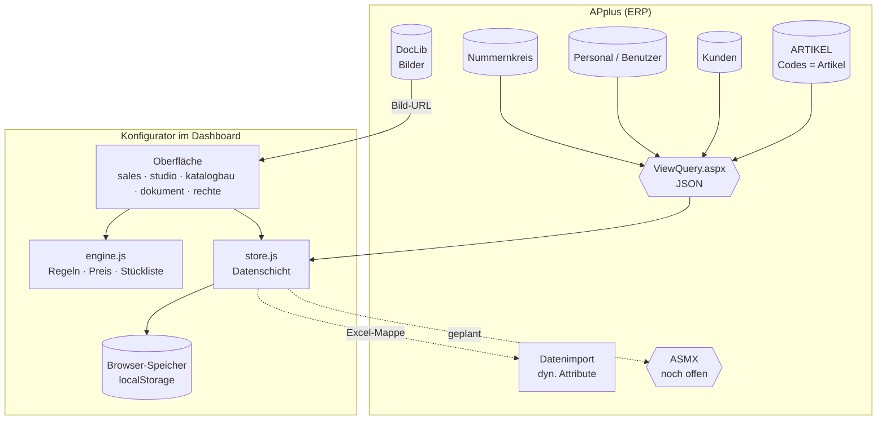

# 09 Ist-Analyse und Zielbild CPQ

Stand: 05.11.2026, Code-Stand Branch `feature/rechte` (PR #4).

Ziel dieses Dokuments: die bestehende Anwendung beschreiben, mit dem Zielbild eines vollständigen CPQ-Systems abgleichen, einen Umsetzungsplan in Phasen festlegen und offen sagen, was nicht geht.

Grundsatz für alle Phasen: **erweitern statt neu bauen.** Neue Funktionen hängen sich an die vorhandenen Module, das vorhandene Datenmodell und die vorhandene Datenschicht `K.Store`.

---

## 1. Ist-Architektur

### 1.1 Laufzeitumgebung

- Reines JavaScript und CSS, ausgeliefert als zwei Dateien `konfigurator.js` und `konfigurator.css`, eingebettet in ein APplus-Dashboard (`#content`).
- Kein Framework, kein Build zur Laufzeit. `tools/bundle.js` fügt die Module zusammen.
- Alle Module hängen an `window.KONF` (`K`).

### 1.2 Module

| Modul | Aufgabe | Wichtige Bausteine |
|---|---|---|
| `core.js` | Konfiguration, Router, Ereignisse, Bibliotheken | `K.cfg`, `K.route`, `K.render`, `K.gehe`, `K.act`/`K.inp` (Ereignisse über `data-act`, `data-in`, `data-chg`), `K.lib`, `K.cfg.loadQuery` |
| `engine.js` | Fachlogik ohne Oberfläche | Vererbung `E.zuordnung`, `E.produktMerkmale`; Feld- und Gruppentypen `E.WERTTYPEN`, `E.GRUPPENTYPEN`; Regeln `E.sperren`, `E.gesetzt`, `E.bereinige`, `E.offenePflicht`; `E.preis`, `E.summen`, `E.stueckliste`, `E.modelltest`; Preise je Familie `E.gruppenPreis`, `E.wertPreis` |
| `store.js` | Datenschicht, einzige Stelle mit Speicherzugriff | Entwurf/Live, `veroeffentlichen`, `endgueltigLoeschen`, `wiederherstellen`, Kunden, Angebote, `naechsteNr`, `log`, Artikelstamm `artikel`, `artikelSuche`, `stammAnwenden`, Abfragen `abfragen()`, `_applusLaden` |
| `sales.js` | Vertrieb | Übersicht, Katalog, Konfigurator, Angebote, Kunden, Verkaufsraum |
| `katalogbau.js` | Studio › Katalog aufbauen | Baum Familie › Fahrzeug › Überschrift › Position, Artikelsuche, Positionsansicht mit Regeln, `K.kbStrukturieren` |
| `studio.js` | Studio | Regeln (Liste, Matrix, Tabellen, Graph), Modelltest, Freigabe, Einstellungen, Protokoll, Experte |
| `modell.js` | Experte › Produktmodell | Familienbaum, Vererbung |
| `excel.js`, `liste.js`, `preise.js` | Importe | Struktur-Import, „Codes und Preise“ je Produktgruppe, Vorlage |
| `dokument.js` | Angebotsdesigner und Dokument | Bausteine, Platzhalter, Seitenumbruch, Briefpapier, Vektor-PDF (pdf-lib) |
| `pdf.js` | Rückfall-PDF (jsPDF) | |
| `viewer3d.js` | 360°-Ansicht (three.js) | |
| `applus-da.js`, `applus.js` | Übergabe an APplus | Datenimport-Mappe für dynamische Attribute, Regeln, Vertriebsstückliste |
| `rechte.js` | Rechte | Benutzer und Rollen aus Abfragen, Sichtbarkeit, Übersicht „Wer sieht was“ |
| `tipps.js` | Erklärungen als (i) | `K.tip`, automatische Umwandlung |
| `app.js` | Navigation, Start | |

### 1.3 Architekturdiagramm



### 1.4 Datenmodell (vorhanden, hat Vorrang)

```text
modell                                  ← Entwurf und freigegebene Version (live)
├─ gruppen[]     Produktfamilien        { id, name, eltern, merkmale[Zuordnung], preise{CODE:Preis}, bild }
├─ produkte[]    Fahrzeuge              { id, code(=ARTIKEL), name, gruppe, basispreis, basiskosten,
│                                         merkmale[Zuordnung], preise{}, codeFolge[], stl[], bild, aktiv }
├─ merkmale[]    Positionen (YY)        { id, code, name, abschnitt(ZZ-Name), abschnittCode, typ, feld, pflicht,
│                                         werte[ { id, code(=ARTIKEL), name, preis, kosten, feld, zahl, text,
│                                                  vorgabe, stl[], apStamm } ] }
├─ regeln[]                             { id, aktiv, produkte[], gruppen[], wenn[{merkmal, op, werte}],
│                                         dann{typ: sperren|nurErlauben|setzen, merkmal, werte}, hinweis }
│                                       | { typ: "tabelle", tabelle{merkmale, zeilen} }
└─ codeTexte{}   Namen der ZZ/YY-Codes
artikel (Map)    aus ARTIKEL-Abfrage    { code, name, preis, kosten, me, gruppe, bild }
kunden[], angebote[], einst{}, protokoll[]
```

**Zu „Codes sind Artikel, keine eigene Code-Tabelle“:** Das ist bereits so umgesetzt. Ein Wert (`werte[].code`) ist immer eine Artikelnummer aus `ARTIKEL.ARTIKEL`. Name und Preis kommen beim Laden aus dem Artikelstamm (`stammAnwenden`), solange sie nicht bewusst überschrieben wurden (`apStamm = false`).

Was die App zusätzlich speichert, ist **keine** zweite Code-Tabelle, sondern die Konfigurationsstruktur, die es im ERP so nicht gibt:
- welcher Artikel bei welchem Fahrzeug in welcher Position steht,
- Feldtyp, Vorauswahl und Reihenfolge,
- Regeln.

Diese Struktur geht über die dynamischen Attribute nach APplus zurück.

### 1.5 Schnittstellen (vorhanden)

| Weg | Richtung | Verwendung |
|---|---|---|
| `…/kidb/dashboard/ViewQuery.aspx?name=<Abfrage>&xhr=json` | lesen | alle Stammdaten. Abfragen: `artikel`, `kunden`, `vertrieb`, `angebotsnummer`, `benutzer`, `rechte`, optional `katalog`, `produkte`, `merkmale`, `codes`, `regeln`, `stueckliste` |
| `<App>/DocLib/<Pfad>` | lesen | Artikelbilder aus `DOCUMENTS` |
| Excel-Mappe für den APplus-Datenimport | schreiben (von Hand) | dynamische Attribute, Regeln, Vertriebsstückliste |
| ASMX | schreiben | **noch nicht vorhanden**, WSDL ausstehend |

**Hinweis zur Vorgabe „REST-Endpunkte“:** Im Code und in den bisherigen Unterlagen gibt es keine REST-Endpunkte, sondern die Dashboard-Abfragen über `ViewQuery.aspx`. Sie liefern JSON und werden weiterverwendet. Gibt es zusätzlich REST-Endpunkte, brauche ich deren Beschreibung (URL, Methoden, Felder, Anmeldung). Ich erfinde keine.

### 1.6 Vorhandene Konzepte

- **Entwurf und Version:** Das Studio pflegt den Entwurf, der Vertrieb arbeitet mit der freigegebenen Version. Gelöschtes verschwindet sofort aus beiden und lässt sich über das Protokoll zurückholen.
- **Vererbung:** Familie › Unterfamilie › Fahrzeug, für Positionen, Werte, Standardauswahl und Preise.
- **Codesystem:** ZZ = Überschrift (wird im Angebot gedruckt), YY = Position, GA = fest. Die Kennungen sind einstellbar.
- **Feldtypen je Code:** Auswahl, Ja/Nein, Zahl, Freitext, fest. **Gruppentypen:** Kacheln, Liste, Dropdown, mehrere.
- **Regeln:** sperren, nur erlauben, setzen, Kombinationstabelle, Hinweistext. Bereinigung nach jeder Änderung, Modelltest.
- **Preise:** Fahrzeug › Familie › Artikelstamm. Rabatt, MwSt. und Summen am Angebot.
- **Rechte:** Rollen aus APplus-Abfragen, Sichtbarkeit je Familie und Fahrzeug, eigene Angebote.
- **Angebot:** Designer mit Bausteinen, Briefpapier, ERP-Nummer, Vektor-PDF, Verkaufsraum-Link.

---

## 2. Abgleich mit dem Zielbild

Legende: ✅ vorhanden · 🟡 teilweise · ❌ fehlt

| # | Ziel | Status | Vorhanden in | Lücke |
|---|---|---|---|---|
| 1 | Kundenauswahl: Suche, Stammdaten, Ansprechpartner | 🟡 | `kunden`-Abfrage, `sales.js` Kunden/Angebot, `kundeAusZeile` | nur **ein** Ansprechpartner je Kunde (Feld `person`). Mehrere Ansprechpartner brauchen eine eigene Abfrage, z. B. auf die Ansprechpartner-Tabelle |
| 2 | Produktfamilien-Auswahl | ✅ | `modell.gruppen`, Katalog-Baum, Katalog aufbauen | – |
| 3 | Artikelauswahl: Filter Sachgruppe/Sachbegriff, Suche, Bilder, Beschreibungen | 🟡 | Suche `artikelSuche` mit Autocomplete; Bilder aus `DOCUMENTS`; Beschreibung am Fahrzeug, `info` an Positionen | **Sachgruppe/Sachbegriff fehlen** im Artikelstamm (bisher nur `gruppe` = Artikelgruppe). Artikel-Langtexte werden nicht geladen. Aktivstatus filtert Ihre Abfrage (`ARTIKELSTATUS = 3`), wird in der App aber nicht angezeigt |
| 4 | Regelwerk: Pflicht, Ausschluss, Abhängigkeit, Warnung | 🟡 | `m.pflicht`, Feldtyp „fest“, Regeln sperren/nur erlauben/setzen, Kombinationstabelle, `hinweis` | Es fehlt eine **echte Warnung**, also eine Regel, die nur warnt, ohne zu sperren. Die Aktion `warning` gibt es in APplus bereits, sie passt in `dann.typ` |
| 5 | Preisberechnung live, Summen | ✅ | `E.preis`, `E.summen`, Gruppenpreise, Rabatt, MwSt. | – |
| 6 | Gewichtsberechnung live, Gesamtgewicht | ❌ | – | Gewicht fehlt im Artikelstamm und in der Engine. Es lässt sich analog zu `kosten` ergänzen |
| 7 | Konfigurationsübersicht | 🟡 | Konfigurator-Tabs „Kalkulation“ und „Stückliste“, Preiszeilen mit ZZ-Überschrift | Eine eigene Übersicht (gegliedert nach ZZ, mit Preis und Gewicht, offenen Pflichtpunkten und Warnungen) fehlt |
| 8 | Angebotsvorschau | ✅ | „Dokument ansehen“, Angebotsdesigner | – |
| 9 | PDF-Erzeugung | ✅ | `K.dok.pdf` (pdf-lib), Briefpapier-PDF | – |
| 10 | Mehrsprachigkeit DE/EN | ❌ | – | Alle Oberflächentexte stehen fest auf Deutsch im Code. Englische Artikeltexte brauchen eine Quelle im ERP |
| 11 | Rollen Vertrieb, Innendienst, Administrator, Händler | 🟡 | `rechte.js`: Administrator, Produktmanagement, Vertriebsleitung, Vertrieb | **Innendienst** und **Händler** fehlen. Sie werden in der vorhandenen Rollentabelle `ROLLEN` ergänzt, nicht als neues System |
| 12 | Erweiterbarkeit Salesforce, Händler-, Endkundenportal | 🟡 | Datenschicht `K.Store` als einzige Speicherstelle; Verkaufsraum als Kundenansicht | Ohne Server-Komponente nicht umsetzbar, siehe Abschnitt 3 |

### Wiederverwendung je Ziel (vor jeder Umsetzung geprüft)

| Ziel | Wird erweitert | Nicht neu gebaut |
|---|---|---|
| Sachgruppe/Sachbegriff | `K.cfg.artikelSpalten`, `artikelSetzen`, Artikelsuche in `katalogbau.js` (`treffer`) | kein eigener Artikelkatalog |
| Gewicht | `artikelSetzen` (Feld `gewicht`), `werte[].gewicht` wie `kosten`, `E.preis` (Zeilen und Summe), Konfigurator-Kopf, Platzhalter im Dokument | keine zweite Berechnung |
| Warnung | `regeln[].dann.typ = "warnen"`, `E.aktiveRegeln`, Regel-Editor in `studio.js`, APplus-Export (`warning`) | kein eigenes Regelsystem |
| Übersicht | `E.preis`-Zeilen (haben bereits `ueberschrift`), `E.offenePflicht`, `E.aktiveRegeln` | – |
| Ansprechpartner | `kunden`-Abfrage plus Abfrage `ansprechpartner`, `kundeAusZeile`, Platzhalter `kunde.person` | – |
| Rollen | `ROLLEN` in `rechte.js`, `R.darf` | – |
| Sprache | eine Übersetzungsfunktion in `core.js`, Texte schrittweise umstellen; `einst.dokumente` je Sprache | – |
| Zentrale Speicherung | dritte Umsetzung von `K.Store` (wie in `store.js` vorgesehen) über die ASMX | Oberfläche bleibt unverändert |

---

## 3. Was nicht oder nur eingeschränkt möglich ist

| Thema | Warum | Was ginge stattdessen |
|---|---|---|
| **Zentral speichern** (Katalog, Angebote, Rechte für alle Rechner) | Abfragen lesen nur. Ohne Schreibschnittstelle liegt alles im Browser des jeweiligen Rechners | ASMX anbinden (Phase 5). Bis dahin die Excel-/SQL-Exporte |
| **Sichere Rechte** | Die Prüfung läuft im Browser, wer sich auskennt, kann sie umgehen | Die APplus-Abfragen selbst je Benutzer filtern; Schreibzugriffe in der ASMX prüfen |
| **Angebotsnummer reservieren** | Eine Abfrage kann keine Nummer vergeben | Reservierung über die ASMX |
| **Händler- und Endkundenportal im Dashboard** | Das APplus-Dashboard ist nur für angemeldete interne Benutzer erreichbar | eigene Webseite außerhalb von APplus (Webserver, Anmeldung, Reverse Proxy). Die App kann als Kern dienen, der Verkaufsraum ist bereits eine Kundenansicht |
| **Salesforce direkt aus dem Browser** | Salesforce braucht OAuth mit geheimen Schlüsseln und erlaubt keine direkten Browser-Aufrufe von fremden Seiten | Anbindung über einen Server (ASMX, Middleware oder Salesforce-Integration in APplus) |
| **Englische Artikeltexte** | nur möglich, wenn APplus sie führt | Abfrage auf die Sprachtexte der Artikel, sonst Pflege in der App |
| **Einzelne Werte im APplus-Attributdialog ausblenden** | APplus-Regelaktionen wirken nur auf ganze Attribute | ist gelöst mit `removeValue` und Warnung |
| **Regelaktionen (SDRPOS) importieren** | laut Referenzmappe nicht im Datenimport | von Hand nach der Regelübersicht, später über die ASMX |
| **Bilder auf dem Testsystem** | Die DocLib ist dort leer | Bilder vom Produktivsystem laden oder DocLib kopieren lassen |
| **Datenmodell aus REST-Endpunkten** | Es sind keine bekannt | Beschreibung liefern, dann binde ich sie über `K.Store` an |

---

## 4. Umsetzungsplan in Phasen

Jede Phase ist ein eigener Branch mit Pull Request, getestet, ohne bestehende Funktionen zu ersetzen.

| Phase | Inhalt | Voraussetzung von Ihnen | Aufwand |
|---|---|---|---|
| **0 Klärung** | Spalten für Sachgruppe, Sachbegriff, Gewicht, Aktivstatus und Langtext in der Artikel-Abfrage; Ansprechpartner-Abfrage; Rollen Innendienst/Händler fachlich; Sprachquelle; ASMX-WSDL | Antworten bzw. Abfragen | – |
| **1 Artikelstamm erweitern** | Felder `gewicht`, `sachgruppe`, `sachbegriff`, `aktiv`, `text` in `artikelSetzen`. Filter nach Sachgruppe und Sachbegriff in der Artikelsuche. Inaktive Artikel markieren und warnen | erweiterte Artikel-Abfrage | klein |
| **2 Gewicht und Übersicht** | Gewicht je Code und Fahrzeug (Stamm, überschreibbar wie Preis), live im Konfigurator-Kopf, in der Kalkulation, in der neuen Konfigurationsübersicht (nach ZZ, Preis, Gewicht, offene Pflichtpunkte, Warnungen) und als Platzhalter im Angebot | Phase 1 | mittel |
| **3 Warnregeln** | Regeltyp „warnt“ in Engine, Editor, Positionsansicht, Modelltest und APplus-Export | – | klein |
| **4 Kunden und Ansprechpartner** | Ansprechpartner-Abfrage, Auswahl im Angebot, Platzhalter | Abfrage | klein |
| **5 Rollen Innendienst, Händler** | Ergänzung in `ROLLEN`. Händler: nur zugeordnete Familien, eigene Kunden und Angebote, kein Studio, ggf. Rabattgrenze | fachliche Festlegung | klein |
| **6 Zentrale Speicherung** | `K.Store` über die ASMX: Katalog, Angebote, Rechte, Nummernvergabe, direkte Übertragung der dynamischen Attribute | WSDL, Rechte | groß |
| **7 Mehrsprachigkeit** | Übersetzungsfunktion, DE/EN-Wörterbuch, Sprachumschalter, Angebotsvorlagen je Sprache, Artikeltexte aus ERP | Sprachquelle | groß |
| **8 Portale, Salesforce** | Konzept und Server-Komponente außerhalb des Dashboards | Entscheidung IT | groß, nicht im Frontend allein |

---

## 5. Offene Fachfragen

1. **Sachgruppe und Sachbegriff:** In welchen Spalten oder Tabellen stehen sie für einen Artikel? Direkt in `ARTIKEL` oder über die dynamischen Attribute (`SACHWERT`)?
2. **Verhältnis zum Codesystem:** Die Struktur entsteht heute aus den ZZ/YY-Codes. Sollen Sachgruppe und Sachbegriff
   - a) nur filtern und die Zuordnung vorschlagen, oder
   - b) die Positionen automatisch bilden, z. B. Sachbegriff = Position?

   Nach dem Grundsatz „bestehendes Modell hat Vorrang“ ist a) der Vorschlag, b) als zusätzliche Option in `K.kbStrukturieren`.
3. **Gewicht:** Liegt es in `ARTIKEL` (welche Spalte, welche Einheit)? Soll das Fahrzeuggewicht aus dem Grundartikel kommen?
4. **Innendienst und Händler:** Was dürfen sie, was nicht (Studio, alle Angebote, Preise, Rabatte, Kosten und Marge sehen)?
5. **Englisch:** Gibt es englische Artikelbezeichnungen in APplus?
